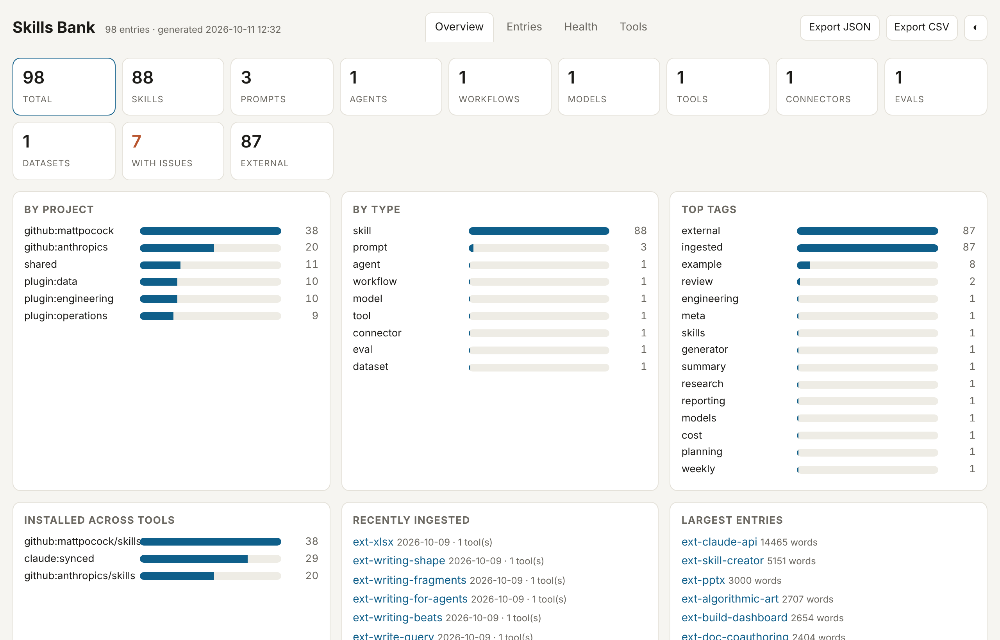

# Skills Bank

**One bank for every AI skill, prompt, agent and rule on your machine.**

You have skills in `~/.claude`, `~/.codex`, `~/.cursor`, `~/.kiro`, a dozen plugins, three GitHub "awesome" repos and a folder of `CLAUDE.md` files. They drift, duplicate, and you can never find the one you wrote last month.

`bank` pulls all of them into one versioned folder, dedupes them, shows them in a dashboard, and pushes the ones you want back out — to Claude Code, Codex, Cursor, or any tool that reads `SKILL.md`.



```bash
pip install git+https://github.com/salahibrahimplq/skills-bank   # installs the `bank` command
bank ingest-all                 # sweep ~50 AI tools + project folders on this machine
bank fetch anthropics/skills    # pull any GitHub skills repo
bank dashboard                  # browse
bank export-skill pdf           # → ~/.claude/skills/pdf  (type /pdf in Claude Code)
```

Zero dependencies. Python 3.9+. Everything is Markdown + YAML in a git repo you own.

## What it does

| | |
|---|---|
| **Ingest** | `SKILL.md` from `~/.claude`, `~/.codex`, `~/.agents`, `~/.kiro`, `~/.roo`, `~/.openclaw`, `~/.config/{goose,devin,crush}`… plus agent definitions, `CLAUDE.md` / `AGENTS.md` / `.cursorrules` / `GEMINI.md` from your projects, and an inventory of every AI tool installed. Same skill in 40 tools → stored once, every location recorded. |
| **Fetch** | `bank fetch owner/repo` clones any GitHub skills repo and ingests it; `bank fetch --update` keeps them fresh. |
| **Find** | Dashboard with search, filters, tag chips, dependency graph, per-tool matrix, health audit. Or `bank search`, `bank list --project x`, `bank use` (pick → clipboard). |
| **Use** | `bank render id k=v k=@file` fills `{{placeholders}}`. `bank run id …` sends it to Claude (API key or the logged-in `claude` CLI). `bank eval` runs test cases. Python SDK, HTTP API, MCP server. |
| **Create** | `bank create-skill "what it should do"` drafts a proper SKILL.md with triggers, inputs, steps, rules; `--improve id "feedback"` iterates. |
| **Export** | `bank export-skill id` → `~/.claude/skills/id/` with its scripts/assets; `--to dir` for project-scoped; `bank sync-tools` copies to every tool that lacks it; `bank unexport` takes it back. |
| **Keep** | git-versioned; optional launchd/cron job ingests + commits + pushes every 10 min. |

## Entry format

Every entry is one Markdown file with frontmatter:

```yaml
---
id: code-review
name: Code Review
type: prompt            # prompt | agent | workflow | skill | tool | connector | eval | dataset | model | instruction
project: shared
tags: [engineering, review]
model: claude-sonnet-5-5
inputs: [diff, language]
uses: [other-id]        # dependency links
version: 1
---
Review this {{language}} diff …
```

Ingested entries carry `origin:`, `source_hash:`, `also_at:` (every other tool it was found in) and `assets:` (supporting files kept in `skills/_assets/<id>/`).

## Commands

```
find:   list search show deps stats dashboard use
make:   new create-skill validate prune index export-skill unexport
run:    render run eval
sync:   fetch ingest ingest-agents ingest-instructions inventory ingest-all discover sources watch sync-tools
expose: mcp serve
```

`bank <command>` with no args prints usage.

## Use from Claude Code (MCP)

```bash
claude mcp add skills-bank -- bank mcp
```

Claude gets `bank_search`, `bank_get`, `bank_render`, `bank_deps`, `bank_skill_writer_prompt`, `bank_add` — it can look up and reuse your prompts, or file new ones, mid-task.

## Use from code

```python
from skills_bank import Bank
b = Bank()
b.render("code-review", diff=open("x.diff").read(), language="python")
b.run("code-review", diff=..., language="python")      # calls Claude
b.search("tender"); b.list(project="jobeng", type="prompt")
```

`bank serve` → `GET localhost:7777/render/<id>?k=v`, `/search?q=`, `/entries`.

## Install properly

```bash
git clone https://github.com/salahibrahimplq/skills-bank ~/.skills-bank
sh ~/.skills-bank/install.sh      # pip install, SKILLS_BANK_HOME, launchd job (macOS)
```

The bank lives in `~/.skills-bank` (or `$SKILLS_BANK_HOME`). Make it a private git repo of your own — ingested content is yours and may carry third-party licences.

## Status

Built for my own use across two businesses and ~60 AI tools; maintained as I need it. Issues and PRs welcome, especially new ingest sources. MIT.
